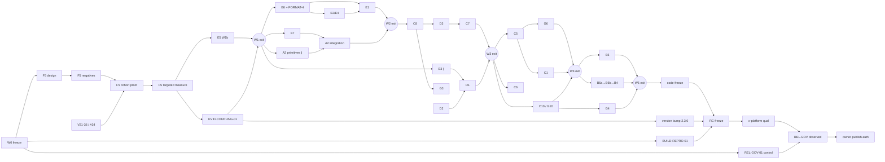

# AISEF v2.3 — DEPENDENCY DAG (W1–W6, one release)

Frozen at W0. Waves are internal milestones of the ONE v2.3 release (plan `AISEF-v2.3-BIG-UPDATE-PLAN.md:37`), not
releases. This file fixes: which wave owns every open item, the edges between items, the critical path, the
lanes and their file ownership, the owner-gated decisions, and each wave's exit gate. Durations are **not**
estimated (no measured capacity; plan:102 "avoid fictional ETAs").

**Inputs actually read for this DAG:** `docs/v2.3/MASTER-CHECKLIST.md` , `docs/v2.3/CODE-AUDIT.md`
, `RISK-REGISTER.md` (:9–:11), `RELEASE-CHARTER.md` (§2 :36–:49, §4 :61–:73), `BASELINE.md`,
`docs/ROADMAP-2.2-CHECKLIST.md`, `docs/IMPROVEMENT-ROADMAP.md`, the plan §3, the owner directive §C, the owner ruling
2026-11-21, `closure-evidence/v2/cycle2/RELEASE-DECISIONS.json` (seq 1–12), `closure-evidence/v2/v2.1/round-5/
{OWNER-ANSWERS-2026-10-18,SCOPE-BEFORE-PIN}.md`, and the code locations cited inline.

**Edge kinds:** `S` = semantic (Y needs X's contract/behaviour); `F` = file handoff (Y edits a file X owns, X merges
first); `G` = gate (owner action, freeze, or qualification must precede Y).

---

## 0. Reconciliation findings that shape the DAG (W0 completeness inputs)

| # | Finding | Evidence | Consequence in this DAG |
|---|---|---|---|
| R1 | **C3b is in scope but had no row in the original 135-ID checklist** (now 147 IDs, R13). Plan W4 names "C3b bounded owner-ratified no_progress control"; directive §B names "owner-approved C3 control"; checklist has only C3a (DONE). | plan:69; directive:39; IMPROVEMENT-ROADMAP.md:76 "(b) Cần owner"; MASTER-CHECKLIST (C3a only) | Added as node `C3b` (W4, built default-OFF, owner ratifies thresholds before enablement). MASTER-CHECKLIST needs a row → 136 IDs. |
| R2 | **Name collision "C4".** Ledger seq 8 `C4_SEPARATE` = *version-forward gated-test wiring*, not roadmap C4 (no-op attempt). | RELEASE-DECISIONS.json seq 8 `decision.C4_SEPARATE`, `constraints[3]`; ROADMAP-2.2-CHECKLIST.md:95 | Roadmap C4 closes in W1 on the existing directive. Ledger-C4 is a separate W1 design check (`EVC-1`, §5). |
| R3 | **v2.3's own version bump re-triggers EVID-COUPLING-01.** `RECORD_REL = newest_rel(_version())[0]` follows pyproject. | release_calibration.py:51–57; p5_acceptance.py:896–898; RISK-REGISTER.md:10 | `EVID-COUPLING-01 -> VERSION-BUMP-2.3.0` is a hard edge onto the release spine. |
| R4 | **CODE-AUDIT #7's diagnosis is superseded.** #7 says gzip differs across Python minors; the measured root cause is preserved file mode bits. | CODE-AUDIT.md:17 vs RISK-REGISTER.md:11 (measured 2026-11-21) | BUILD-REPRO-01 work is the mode normalisation + contract test from RISK-REGISTER:11. Fix #7's text at W1 adjudication. |
| R5 | **CI needs a push, but the branch is local-only** (CODE-AUDIT holds security findings). Every wave exit needs the 6 unit legs + sealing on GitHub. | BASELINE.md:72–73; RELEASE-CHARTER.md:38–39 | `DISC-1` (disclosure review / sanitised CI branch) gates **every** wave's exit CI. Owner STOP (publication control), §5. |
| R6 | **F2 vs "no allowlist masking."** F2 generates a release exception set; the charter forbids allowlist masking. | MASTER-CHECKLIST; RELEASE-CHARTER.md:36 | F2 markers are allowed only for sealing/platform-harness categories, each with a positive assertion. A product-category marker fails the meta-test. |
| R7 | **G4 (W5) shares files with C10/G10 (W4).** All three change what the developer is served (`feedback.py:44 task`, `:68 retry_feedback`, `:128 context_pack`). | plan:69,75; directive:57,59 | `C10, G10 -F-> G4`. G4 is W5-main and carries C10/G10 content as files. |
| R8 | **DO-\* rows are measurement events.** In v2.3 the wave exit gates replace them. | MASTER-CHECKLIST; ROADMAP-2.2-CHECKLIST.md:111,132,143 | Each DO-\* row closes at the exit of the wave that holds its last v2.3-homed constituent (wave table). |
| R9 | **Lane-M is DONE in the checklist but unticked in the roadmap.** | MASTER-CHECKLIST; ROADMAP-2.2-CHECKLIST.md:97 | W1 integrator reconciles the box. No re-measurement. |
| R11 | **E5 is a W1 P1 dependency** (owner ruling: "W1 = F5 incremental qualification FIRST + the three P1 dependencies"; the P1s are REL-GOV-01 #1, E5 #2, EVID-COUPLING-01 #3). | owner ruling 2026-11-21; CODE-AUDIT #1–#3 | E5 (+ V21-23 duplicate, #2, #39a; #39b goes to W2b) moves from W2a to **W1b**, landed only after W1a's F5 gates; L1-LIFECYCLE owns `aisef2/orchestrate/story_runner.py` and `aisef2/app/run.py:693` (refusal branch) only. E6/E7/E1 stay W2. |
| R12 | **Measured kernel-change blast radius:** one neutral comment line in `story_runner.py` stales 11 targets/411 mutants **and** turns Q0, `b1_bindings_check`, currency-DAG, p5/conformance and 13/18 sealing-GATED tests red. | W1-DESIGN.md M4 (probe `62cba92b`, throwaway worktree) | New node **F5-ROUND** (round-scoped evidence: v2.2 replays at v2.2.0; branch gated by declared-input identity). `F5-ROUND -> E5` is a hard edge. |
| R13 | **W0-closure corrections** changed 24 open rows (owner-dec ×2, ID-quality ×2): e.g. V21-34/59/60/67/72/74/87/88 are not decisions (NEW_WORK); V21-05/07/08/28 become D1–D3 acceptance items because the v2.3 charter now claims confinement. | MASTER-CHECKLIST.md last column | Assigned in §1c. The checklist's Wave column is authoritative. |
| R14 | **Gap-fill audit found 59 more defects** (#46–#104: P1 5, P2 21, P3 33) after this DAG's first draft. | CODE-AUDIT.md §Gap-fill | Wave/lane in CODE-AUDIT (adjudication pass); P1s verified adversarially. |
| R10 | **Unassigned trust surfaces from the critic:** `aisef2/plan/`, `aisef2/quality/`, `aisef2/cohort/`, `validation/v2` authority checkers. | audit.json `critic` | Every file has one owner per wave (§4). `aisef2/cohort/**`, `validation/v2/{destructive_authority,cleanup_authority,refmodel_independence,v1_evidence_guard,except_boundaries}.py` are **read-only in all waves**. Editing them requires an amendment (INV-MUTATION-AUTHORITY). |

---

## 1. Wave table — every NEW_WORK ID and every open defect, exactly one wave

### 1a. NEW_WORK (first draft: 58; after the W0-closure corrections 69 — §1c) + gap + risk-register IDs + roadmap C4

| Wave | Lane | IDs (checklist line) |
|---|---|---|
| **W1** | L1-F5 | **F5**, **V21-40** |
| W1 | L1-F2 | **F2** |
| W1 | L1-TESTENV | **V21-36**; V21-74, V21-87 closed NOT_APPLICABLE by the delegated ruling (owner item 6) |
| **W1b** | L1-LIFECYCLE | **E5**, **V21-23** (DUPLICATE of E5) — after W1a's F5 gates (R11) |
| W1 | L1-QUAL / L1-BUILD / L1-CIGOV | risk IDs **EVID-COUPLING-01**, **BUILD-REPRO-01**, **REL-GOV-01** (RISK-REGISTER:9–11). Not among the 135; tracked here. |
| W1 | integrator | **C4** (qualified decision, closed on the existing ruling after its test, §5). Lane-M box reconcile (R9). |
| **W2** | L2-LIFECYCLE | **V21-27**, **V21-34** (R13) — E5/V21-23 moved to W1b (R11) |
| W2 | L2-PROBE-OS | **E3**, **V21-26**, **V21-59**, **V21-60**, **V21-88** (R13, critic fix: one lane) |
| W2 | L2-SIGN → L2-AUTH | **A2** |
| W2 | L2-JOURNAL | **E6**, **V21-10** |
| W2 | L2-RECORD | **E7**, **V21-35** |
| W2 | L2-ACCOUNTING | **E2**, **E4** |
| W2 | L2-AUTH | **E1**, **V21-19**, **V21-49** |
| **W3** | L3-SANDBOX | **D1**, **D2**, **V21-02** |
| W3 | L3-CLIENT | **C8**, **C7**, **G3**, **D3**, **V21-29** |
| W3 | L3-PLATFORM | **V21-41** |
| **W4** | L4-PARALLEL | **C5**. G9 (:124, design reference only) is consumed here. |
| W4 | L4-REVIEWER | **C6** |
| W4 | L4-CONTEXT | **C10**, **G10**, **V21-03** |
| W4 | L4-RESUME | **G6** |
| W4 | L4-MONITOR | **C1**, **C3b** (gap R1) |
| W4 | integrator | **DO-DOT-4**. Closes at W4 exit, when its last v2.3-homed constituent (C1/G6) is measured. ~~B2, also a Đợt-4 item, is re-homed to W6 by plan:81, so DO-DOT-4 cites B2's W6 gate instead of waiting for it.~~ [SCOPE AMENDMENT 2026-11-26: REMOVED_FROM_V2.3_RELEASE_SCOPE_BY_OWNER — see amendments/SCOPE-B2-EXTERNAL-REMOVED.md] B2's W6 gate no longer exists; DO-DOT-4 closes at the W4 exit on C1/G6 alone. |
| **W5** | L5-EARLY | **V21-43**, **V21-47**, **V21-52** |
| W5 | L5-AUTHOR | **B6a**, **B6b**, **B6c**, **B6d**, **B4**, **V21-44**, **V21-45**, **V21-46**, **V21-48**, **V21-50**, **V21-51**, **V21-53**, **V21-64** |
| W5 | L5-FEEDBACK | **G4**, **V21-04** |
| W5 | L5-GATEWAY | **B5**, **E8** (NEW_WORK: written re-evaluation at B5's design freeze; reversal only if B5/C8 require it) |
| W5 | integrator | **DO-CUOI-DOT-3**, **DO-CUOI-DOT-5**. Both close at W5 exit: B5, B4, B6\* and G4 are their last constituents. G3 was measured at W3. |
| **W6** | L6-EVAL | **B2** — status REMOVED_FROM_V2.3_RELEASE_SCOPE_BY_OWNER [SCOPE AMENDMENT 2026-11-26: see amendments/SCOPE-B2-EXTERNAL-REMOVED.md]. Node kept because other rows reference it; the external evaluation campaign is out of release scope (Tier-0 code/tests retained). (Historically: owned `aisef2/cohort/**` for #64–#66 by the §4(d) amendment.) |

### 1c. W0-closure additions (R13) — the remaining open rows, each in exactly one wave

| Wave | Lane | IDs |
|---|---|---|
| W1 | L1-TESTENV (test) + integrator (closure text) | **C4** (qualified: candidate==base makes 0 reviewer/scanner/quality calls → WONT_DO) · risk IDs EVID-COUPLING-01, BUILD-REPRO-01, REL-GOV-01 as checklist rows |
| W3 | L3-SANDBOX | **V21-05**, **V21-07**, **V21-08**, **V21-28** (D1–D3 acceptance items), **V21-11** (verifier scope from its own StoryScope), **V21-72b** (real-bwrap canary) |
| W4 | L4-REVIEWER | **V21-67** (DEPTH_MAX kept; `app/adapters.py`); OWNER_DECISION V21-65b (default keep) |
| W5 | L5-AUTHOR | **V21-39** (examples `.gitignore`), **V21-72a** (operator pointer on stdout, `cli.py:110`); OWNER_DECISION V21-61b |
| W5 | L5-EARLY | **V21-42b** (stale 2.1 docs: drafted under `docs/v2.3/drafts/`, lands on master) |
| W5 | L5-FEEDBACK | OWNER_DECISION V21-58 (default keep, answered with V21-57) |
| W2 | L2-PROBE-OS | OWNER_DECISION V21-24, V21-25, V21-70, V21-71b (asked at the W2 E3 design freeze; default keep) |
| W2 | L2-LIFECYCLE | OWNER_DECISION V21-57 (a new code, if wanted, enters FORMAT-4 at the W2 freeze; default keep) |
| W2 | L2-AUTH | OWNER_DECISION V21-54 (A2 design freeze; default keep (A)) |
| W1 | L1-F5 | **KERNEL-COUPLING-01**, **EVID-SCALE-01**, **EVID-PLATFORM-01** (F5-ROUND, W1-DESIGN §2.4/§2.6/§2.9; scale = SCALE-1) |

Original draft count (before §1c/R11): W1 4 + W2 15 + W3 9 + W4 8 + W5 21 + W6 1 = **58 NEW_WORK**. After the W0-closure
corrections MASTER-CHECKLIST holds **147 IDs: 69 NEW_WORK** (incl. C3b, E8, V21-72a/b and the 6 risk IDs) and **9
OWNER_DECISION**; its Wave column is authoritative. The 9 open OWNER_DECISION rows (+ 7 W0-closure items) are in §5a. ALREADY_FIXED/DONE/NOT_APPLICABLE rows are not re-opened; a regression test that
touches them is covered by the owning wave's exit gate.

### 1b. CODE-AUDIT defects #1–#45 (adjudicated at the W0 closure; #46–#104 in §1d)

| # | Sev | Wave | Lane | Dup-of / folds into | # | Sev | Wave | Lane | Dup-of / folds into |
|---|---|---|---|---|---|---|---|---|---|
| 1 | P1 | W1 | L1-CIGOV | REL-GOV-01 | 24 | P3 | W5 | L5-GATEWAY | B5 cleanup |
| 2 | P1 | **W1b** | L1-LIFECYCLE | E5 (R11); acceptance = W1-DESIGN §4.5 matrix | 25 | P3 | W3 | L3-CLIENT | C7/G3 identity |
| 3 | P1 | W1 | L1-QUAL | EVID-COUPLING-01 | 26 | P3 | W2 | L2-LIFECYCLE | (V21-57 family) |
| 4 | P2 | W5 | L5-GATEWAY | B5 | 27 | P3 | W5 | L5-AUTHOR | — |
| 5 | P2 | W4 | L4-PARALLEL | C5 prerequisite | 28 | P3 | W5 | L5-AUTHOR | — |
| 6a/6b | P2 | W1 / W2 | L1-CIGOV / L2-CI | split: 6a offline demo + historical-2.2 read (W1); 6b signed verify + expected-bad (W2) | 29 | P3 | W1 | L1-CIGOV | owner action (§5) |
| 7 | P2 | W1 | L1-BUILD | BUILD-REPRO-01 (R4) | 30 | P3 | W1 | L1-CIGOV | — |
| 8 | P2 | W3 | L3-CLIENT | C7 | 31 | P3 | W3 | L3-SANDBOX | V21-41 family |
| 9 | P2 | W3 | L3-CLIENT | D3 | 32 | P3 | W1 | L1-F5 | Lane-M registry |
| 10 | P2 | W2 | L2-SIGN | A2 | 33 | P3 | W1 | L1-F5 | Lane-M registry |
| 11 | P2 | W2 | L2-JOURNAL | E6 | 34 | P3 | W1 | L1-TESTENV | — |
| 12 | P2 | W2 | L2-ACCOUNTING | E2/E4 | 35 | P3 | W5 | L5-EARLY | — |
| 13 | P2 | W2 | L2-AUTH | V21-19 (DUPLICATE) | 36 | P3 | W5 | L5-EARLY | — |
| 14 | P2 | W1 | L1-F5 | F5 negative case | 37 | P3 | W5 | L5-EARLY | owner design intent (§5) |
| 15 | P2 | W1 | L1-F5 | F5 negative case | 38 | P3 | W1 | L1-F5 | F5 stale case |
| 16 | P2 | W2 | L2-PROBE-OS | E3 lane | 39a/39b | P3 | **W1b** / W2b | L1-LIFECYCLE / L2-ACCOUNTING | 39a: every UNKNOWN E5 writes names the real type (W1b); 39b (W2b, L2-ACCOUNTING owns the story_runner.py:325 hunk; `Merged.original` comes from W2a L2-LIFECYCLE in merge.py) |
| 17 | P2 | W1 | L1-QUAL | EVC (append-only correction) | 40 | P3 | W1 | L1-QUAL | EVID-COUPLING-01 (same file) |
| 18 | P2 | W2 | L2-RECORD | E7 | 41 | P3 | W2 | L2-RECORD | G6 prerequisite |
| 19 | P2 | W3 | L3-SANDBOX | D1/G1 | 42 | P3 | W2 | L2-RECORD | E7 |
| 20 | P2 | W3 | L3-SANDBOX | D3 (DUPLICATE of #9 surface) | 43 | P3 | W3 | L3-SANDBOX | D2 (DUPLICATE) |
| 21 | P2 | W3 | L3-SANDBOX | D1 (DUPLICATE) | 44 | P3 | W2 | L2-AUTH | — |
| 22 | P2 | W2 | L2-AUTH | A2 (DUPLICATE of #10 surface) | 45 | P3 | W2 | L2-AUTH | — |
| 23 | P3 | W5 | L5-GATEWAY | — | | | | | |

Count (after R11): W1 13 (1,3,7,14,15,17,29,30,32,33,34,38,40) + W1b 2 (2,39a) · W2 13 (6,10,11,12,13,16,18,22,26,41,42,44,45) · W3 8
(8,9,19,20,21,25,31,43) · W4 1 (5) · W5 8 (4,23,24,27,28,35,36,37) · W6 0 = **45**.

### 1d. Gap-fill defects #46–#104 (R14)

Wave and lane per defect are in `CODE-AUDIT.md` (adjudication pass + adversarial P1 verification: all five gap-fill
"P1"s were reproduced and downgraded to P2 — no false PASS reachable as claimed). Totals over all 104 defects:
W1 30 · W1b 2 · W2 21 · W3 30 · W4 8 · W5 12 · W6 3 (over 106 rows: #6 split 6a W1 L1-CIGOV / 6b W2 L2-CI; #39 split 39a W1b / 39b W2). New W1 lane **L1-AUTHCHK** holds the 12 authority-checker
hardening defects (#47–#59 family: `destructive_authority`, `cleanup_authority`, `except_boundaries`,
`refmodel_independence`, `kernel_static_checks`, `probe_static_checks`, `authority_limits`) under the §4(d)
amendment below. The three `aisef2/cohort/` defects go to W6 L6-EVAL (B2 preregistration is their only consumer).
[SCOPE AMENDMENT 2026-11-26: REMOVED_FROM_V2.3_RELEASE_SCOPE_BY_OWNER — see amendments/SCOPE-B2-EXTERNAL-REMOVED.md —
B2 external evaluation is out of release scope; #64–#66's only consumer was B2 preregistration, so their disposition
is an open question for the owner, not silently dropped.]

Duplicates, not separate work: #13≡V21-19; #20 is the egress face of #9/D3; #21≡D1; #22 is the verify face of #10/A2;
#43≡D2; V21-23≡E5. Already-fixed residues stay closed: V21-30 (MASTER-CHECKLIST) is subsumed only as A2's
authenticity half. V21-37/38 (:89–:90) must not be redone.

---

## 2. Edge list (plain text — authoritative; the Mermaid in §2b is a view of it)

```
# --- W0 → all
W0-FREEZE            -> every W1 node        [G] design freeze before code (ROADMAP-2.2-CHECKLIST.md:24; directive:63)
COMPAT-MATRIX (W0)   -> FORMAT-4, A2, E2, E4, E7, #41, BUNDLE-FORMAT-2
                                             [G] keep 2.2.0 readers or a versioned migration (RELEASE-CHARTER.md:64-65)
DISC-1               -> every wave exit CI   [G] branch local-only (BASELINE.md:72-73); 6 legs + sealing run only on GitHub

# --- W1 internal (F5 first; no campaign before the impact design is proven — owner ruling:9-14)
V21-36               -> F5-COHORT            [S] kill-test identity is an impact input; a real client on PATH makes a kill host-dependent (MASTER-CHECKLIST)
#34                  -> F5-COHORT            [S] sticky _ARMED/_RUNTIME_ARMED (registry.py:353,459) make a kill depend on test order
F5-DESIGN            -> F5-NEG               [S] the impact-input schema (source+closure, generator, kill-test, transitive deps, platform, provenance) is what the negatives attack
F5-NEG               -> F5-COHORT            [S] stale / tampered / mismatched-platform / unauthorized evidence must FAIL before any reuse is trusted
#14, #15             -> F5-NEG               [S] the only reuse path checks the ruling by .is_file() (mutation.py:1642) and has no test → it is the "unauthorized" negative
#38                  -> F5-NEG               [S] currency_dag.py:119: a missing own-supersession is not a problem → the "stale" negative
V21-40               -> F5-DESIGN            [S] source identity must be the committed form, not the working file (execution_order.py:74-77)
F5-COHORT            -> F5-MEASURE           [S] targeted measurement only on the proven affected scope; v2.2 records (incl. the 42-target one-off, mutation.py:1570-1575) replay byte-identically
#32, #33             -> F5-MEASURE           [S] require_armed stale record (mutation.py:1275-1277) + mechanism_digest/_identity untargeted (registry.py:284,299) join the affected scope
F5 (typed states)    -> EVID-COUPLING-01     [S] RECORD_REL follows pyproject (release_calibration.py:57) → a bump must resolve to a typed VERIFIED_REUSE record; --write must not rewrite aisef2/app/calibrations.py (RISK-REGISTER:10)
EVID-COUPLING-01     -> #40                  [F] same file p5_acceptance.py (:782,:804,:851)
F5                   -> #17                  [S] C2-FINAL freeze digest (c2_closure_audit.py:721-726) is expressed as INVALIDATED/UNRESOLVED + an append-only correction, never an edit
F5                   -> F2                   [S] release_qualify consumes typed reuse states, not a version-scoped allowlist (R6)
F5                   -> CI-INCR-JOB          [S] the incremental mutation job (L1-CIGOV) calls the F5 engine
EVC-1 (owner check)  -> EVID-COUPLING-01     [G] ledger seq 8: "no automatic migration of gated tests onto new records" (R2)
F5-NEG, F5-COHORT    -> F5-ROUND             [S] R12: v2.2-round evidence replays at v2.2.0; the branch is gated by chain-head selection + each node's own guard (W1-DESIGN §2.6)y (W1-DESIGN §2.6)
F5-ROUND             -> E5 (W1b)             [S] R12: without it a neutral story_runner.py byte reds 13/18 sealing-GATED tests, Q0, b1, currency-DAG
F5-MEASURE           -> E5 (W1b)             [S] E5 is the first representative one-function kernel change measured cold vs incremental
E5 (W1b)             -> W1-EXIT              [G] owner ruling: E5 before G6/C5/G9/C1; landed with fault-injection tests (#2)
W1-GATES (#6 part)   -> W2 kernel lanes      [S] offline run + demo + historical-2.2 read are in CI before any format change (tests.yml:144-146 has run/--verify smoke only)

# --- W1 → spine
F5                   -> E5 and every aisef2/ change in W2–W5
                                             [S] a kernel edit re-opens mutation/calibration records (deferrals at MASTER-CHECKLIST,72,73,141)
EVID-COUPLING-01     -> VERSION-BUMP-2.3.0   [S] R3
BUILD-REPRO-01       -> RC-FREEZE            [S] repro_dist.py keeps member modes (RISK-REGISTER:11)
REL-GOV-01           -> PUBLISH              [G] release.yml:76 `environment: pypi`, protection_rules [] (RISK-REGISTER:9)

# --- W2 (owner ruling:17-18: E5 early — E5 itself lands in W1b, R11; directive:53: E5 before E1/E6/E7)
E5                   -> E6, E7, E1           [S] owner ruling; the contained-fault path (W1-DESIGN §4.3 H4: false decision, UNKNOWN, rollback, dispose, end) exists before the table/record/verdict encode them
E5                   -> E2, E4               [F] provider/result is appended inside _attempt (story_runner.py:243,252)
E5                   -> #39a                 [F] _fail (story_runner.py:161-164); #39b (W2b) needs `Merged.original` (merge.py, W2a L2-LIFECYCLE) -> story_runner.py:325 (W2b L2-ACCOUNTING)
E5                   -> V21-23               [S] DUPLICATE — E5 replaces _attempt (story_runner.py:183)
INV-IX static proof  -> E5 acceptance        [G] no gate row before its stage call (ALL_CONTROL_DECISIONS_JOURNAL_BACKED broke C4, ROADMAP-2.2-CHECKLIST.md:95)
E6 (FORMAT-4 freeze) -> E2, E4               [S] reservation in provider/request (format3.py:146), segment digest in provider/result (format2.py:130)
E6 (FORMAT-4 freeze) -> C7, G6, C5           [S] provider/attestation, completion marker and closing-identity schemas are frozen at W2 → one new writer format for all of v2.3
E6                   -> E1                   [S] the verdict fold reads the one transition table (format3.py:173 vs projections/story_state.py:19)
E6                   -> V21-10               [F] format3.py:195,266
E7                   -> #18, #42, #41, V21-35
                                             [F] run.py:710, :722, :98, :253
E7                   -> A2-INTEGRATION       [F] the signed head/anchor attach in the refactored finalize (anchor_of run.py:446)
A2-PRIMITIVES        -> A2-INTEGRATION       [S] keyed head + off-box public half (QĐ#1, ROADMAP-2.2-CHECKLIST.md:51)
E2, E4               -> E1/_spend            [S] verify checks each stream segment before re-deriving spend (verify.py:78; IMPROVEMENT-ROADMAP.md:131)
E1                   -> V21-19               [S] the verdict fold is VIII's production caller: only harness records pass invariants.evidence.admit (evidence.py:47)
A2-INTEGRATION       -> V21-49, #22          [F] verify.py notes / expect-anchor semantics (verify.py:167-172)
A2-INTEGRATION       -> #6 (closure)         [S] signed --verify --expect-pubkey + expected-bad controls (RELEASE-CHARTER.md:39-40)
E3                   -> V21-26, #16          [S/F] the controller-spawn OS tier is V21-26's remedy (cli_invocation.py:111); process_effect.py:907

# --- W2 → W3
E3                   -> D1                   [S/F] D1 wraps the probe controller + test runner; E3 redefines the controller spawn (process_effect.py:680 do_subprocess)
E2, E4, FORMAT-4     -> C7                   [S] attestation probes are spend and go through the ledger (IMPROVEMENT-ROADMAP.md:88)
E2 (L2-ACCOUNTING)   -> C8                   [F] client.py Budget/spend changed in W2b; C8 restructures client.py next
A2                   -> V21-41(b)            [F] lineage.py anchors (:335,:839) are rewritten by A2 first
C8                   -> C7, G3, D3           [S/F] ClientAdapter argv/config_endpoint/parse_stream/identity: C7=parse_stream served model, G3=identity, D3=config_endpoint→broker (IMPROVEMENT-ROADMAP.md:91)
D3                   -> C7                   [S] when confinement is on, attestation probes use the broker transport (same endpoint+key)
D3                   -> #20                  [S] egress is closed only when the session's sole route is the broker (confine.py:164 --share-net)
C8, D3               -> V21-29               [S] bind the attested endpoint to session routing (client.py:251-258)
D2                   -> D1 (macOS accept)    [S] wrap() raises Unavailable off Linux (confine.py:181-182)

# --- W2/W3 → W4
E5, E6, E7           -> C5                   [S] typed stages + table + run_stories() split are the dispatch seam (IMPROVEMENT-ROADMAP.md:134)
#5                   -> C5                   [S] Project.order (bundle.py:124-136) must reconcile story vs criterion depends_on before waves derive from it
G9 (reference)       -> C5                   [S] parallel run, serialized append + closing identity check (IMPROVEMENT-ROADMAP.md:203-205)
C5                   -> G6                   [S/F] per-story worktrees change the fingerprint's "base"; run.py handoff
E5, E6, E2, E4, A2, #41
                     -> G6                   [S] closed-story marker, no unaccounted replay (plan:71), never rewrites signed history (directive:57), stable kernel_digest (run.py:93-99)
E5, C8               -> C1                   [S] owner ruling; poll loop wait_within (client.py:269) moves behind the adapter
C5                   -> C1                   [S] the monitor grades per-story snapshots taken from C5's per-story worktrees
C7, C8, E2, E4       -> C6                   [S] per-route attestation, own ledger + cost line
BUNDLE-FORMAT-2      -> C10, G10             [S/F] optional public transcripts / developer-harness layer (L4-PARALLEL owns bundle.py)
V21-19, E1           -> G10                  [S] lessons are Context (evidence.py:25), refused as evidence
G1 (DONE, tripwire)  -> C10, G10             [S] served content is scanned before serve
C3a (DONE), E6       -> C3b                  [S] policy reads a journal projection, no side counter (IMPROVEMENT-ROADMAP.md:76)

# --- W4 → W5
C10, G10             -> G4                   [F/S] R7
BUNDLE-FORMAT-2      -> B6b, B4              [S] seal/draft emit format/2; 2.2 project/1 still loads
B6a                  -> B6b, B4              [S] classify_or_reason feeds seal/lint/draft retry feedback
B6b                  -> B4                   [S] seal derives hashes; draft signs nothing (IMPROVEMENT-ROADMAP.md:51)
C8                   -> B4                   [S] model call through an adapter (offline fake model first)
B6c                  -> V21-45, V21-64       [F] probe/catalog.py
E1, E5, A2, C8, D1, #4
                     -> B5                   [S] re-derived verdict, stage seam, signed evidence, no OpenCode, confined untrusted diff, no false-blocking within_s (review_verify.py:300)
B5-FREEZE            -> E8 re-evaluation     [G] E8 only if B5/C8 require it (IMPROVEMENT-ROADMAP.md:143; ROADMAP-2.2-CHECKLIST.md:142)
V21-11 (D1, W3)      -> B5, C6               [S] the verifier probe runs in its own StoryScope sandbox/worktree (proof.py:89-98); decided, not a gate

# --- W5 → W6
W2..W5 exits         -> CODE-FREEZE          [G]
# [SCOPE AMENDMENT 2026-11-26: REMOVED_FROM_V2.3_RELEASE_SCOPE_BY_OWNER — see amendments/SCOPE-B2-EXTERNAL-REMOVED.md]
# The three B2 edges below are REMOVED by the owner ruling (kept, commented, for history — no longer in force):
#   B2-ORACLE-SIGNED   -> B2-MEASURE         [G] freeze + sign labels before measuring (IMPROVEMENT-ROADMAP.md:45; plan:81)
#   CODE-FREEZE        -> B2-MEASURE         [S] the oracle measures the RC kernel's delivery()
#   B2-MEASURE         -> RC-FREEZE          [G] a P0/P1 false-PASS here = NO-GO with one owner decision, no loop (plan:83)
CODE-FREEZE          -> RC-FREEZE            [G] direct edge since 2026-11-26. RC-FREEZE's prerequisites are exactly:
                                                 CODE-FREEZE, VERSION-BUMP-2.3.0, BUILD-REPRO-01, PUBLIC-DOCS (README)
                                                 — no B2 item among them.
VERSION-BUMP-2.3.0   -> RC-FREEZE            [S]
RC-FREEZE            -> XPLAT-QUAL -> REL-GOV-OBSERVED -> OWNER-PUBLISH-AUTH -> PUBLISH
PUBLIC-DOCS (README) -> RC-FREEZE           [S] README is SHIPPED (release_rc.py:73) and frozen at RC-FREEZE (:105, :118-121); W1-DESIGN §6
PUBLIC-DOCS (master) -> PUBLISH              [G] README/docs land on master only (CLAUDE.md "Docs sửa trên master"; RELEASE-CHARTER.md:70-71)
```

### 2b. Mermaid view



---

## 3. Critical path

Durations are unmeasured, so the critical path is the **longest chain of hard edges**. Where two chains tie in
depth, both are listed. Whichever runs longer in measured time is critical.

```
W0-FREEZE → DISC-1 (CI available) → V21-36/#34 → F5-DESIGN → F5-NEG → F5-COHORT → F5-ROUND → F5-MEASURE
→ E5 (W1b) → [W1 exit]
→ E6/FORMAT-4 → E2/E4 → E1 + A2-INTEGRATION → #6 signed gate → [W2 exit]
→ C8 → D3 → C7 → [W3 exit]          (tie: E3(W2) → D2 → D1-macOS acceptance → [W3 exit])
→ #5 → C5 → G6 → [W4 exit]          (tie: C5 → C1)
→ B5  ∥  B6a → B6b → B4 → [W5 exit] (B5 needs D1, C8, E1, A2 — all already upstream)
→ CODE-FREEZE → VERSION-BUMP-2.3.0 (needs EVID-COUPLING-01) → RC-FREEZE
→ XPLAT-QUAL → REL-GOV-OBSERVED → OWNER-PUBLISH-AUTH

# [SCOPE AMENDMENT 2026-11-26: REMOVED_FROM_V2.3_RELEASE_SCOPE_BY_OWNER — see amendments/SCOPE-B2-EXTERNAL-REMOVED.md]
# was: → CODE-FREEZE → B2-ORACLE-SIGNED → B2-MEASURE → VERSION-BUMP-2.3.0 (needs EVID-COUPLING-01) → RC-FREEZE
```

Off-path but release-blocking (they must finish before their join node): BUILD-REPRO-01 → RC-FREEZE; REL-GOV-01
owner config → REL-GOV-OBSERVED; PUBLIC-DOCS on master → PUBLISH. The owner STOPs DISC-1 and EVC-1 sit **on** the
path. ~~and B2-SPEND (§5)~~ [SCOPE AMENDMENT 2026-11-26: REMOVED_FROM_V2.3_RELEASE_SCOPE_BY_OWNER — see
amendments/SCOPE-B2-EXTERNAL-REMOVED.md — B2-SPEND is no longer an owner STOP on the path.]

---

## 4. Lanes and file ownership

Rules: (a) one owner per file per phase. A file not listed in a phase is **read-only** in that phase. (b) A lane that
needs a hunk in a file it does not own asks the owner lane for it (single writer). (c) Never `git stash` while lanes fan
out. Suites are judged on the main tree, not in worktrees (CLAUDE.md). (d) Read-only in **all** waves unless amended:
`aisef2/cohort/**`, `validation/v2/{destructive_authority,cleanup_authority,refmodel_independence,v1_evidence_guard,
except_boundaries}.py`, every existing file under `closure-evidence/**`. New records are append-only under
`closure-evidence/v2/v2.3/`.
**Amendment (W0 closure, R14):** in W1 only, lane L1-AUTHCHK may make **tightening-only** edits to those authority
checkers (+ `kernel_static_checks.py`, `probe_static_checks.py`, `validation/qualification/authority_limits.py`) and
append rows to `destructive_sites.json`. Each edit lands with a red-before fixture, never removes a rule, never relaxes
a match, and keeps INV-MUTATION-AUTHORITY. The Q0 record must stay byte-identical (live-tree `clean()` = [], known-bad
messages unchanged); if it cannot, STOP Q0-1. In W6 only, L6-EVAL may edit `aisef2/cohort/**` for #64–#66.

### W1 — two phases. **W1a: no `aisef2/` file is edited** (kernel tree stays `e865d65c`, BASELINE.md:77); lanes parallel. **W1b: L1-LIFECYCLE edits `aisef2/orchestrate/story_runner.py` and `aisef2/app/run.py:693` (refusal branch) only**, after W1a's F5 gates pass (R11). Exact files per lane: identical to W1-DESIGN.md §8 (copied at the W0 freeze).

| Lane | Items | Owns (edit) |
|---|---|---|
| L1-LIFECYCLE (W1b) | E5, V21-23 (dup), #2, #39a | `aisef2/orchestrate/story_runner.py` (`Stage`, `_Stages`, the `_attempt` handler; imports only added); `aisef2/app/run.py` (the refusal branch at :693 only, §4.4); the append-only kill-set/target hunk in `validation/v2/mutation.py` goes through L1-F5; NEW `tests/v2/{test_v23_story_lifecycle,test_v23_story_golden}.py` (identical to W1-DESIGN §8) |
| L1-AUTHCHK | the 12 authority-checker gap defects (CODE-AUDIT, lane L1-AUTHCHK) | `validation/v2/{destructive_authority,cleanup_authority,except_boundaries,refmodel_independence,kernel_static_checks,probe_static_checks}.py`, `validation/qualification/authority_limits.py`, `destructive_sites.json` (append only), their tests; NEW red-before fixtures under `tests/v2/fixtures/` (identical to W1-DESIGN §8) |
| L1-F5 | F5, F5-ROUND, KERNEL-COUPLING-01, V21-40, #14, #15, #32, #33, #38, #46, #77 (new `aisef2/plan/obligation.py` mutation targets) | `validation/v2/{mutation,currency_dag,version_forward,execution_order,checker_calibration,b1_bindings_check}.py` (mutation.py: F5 source rule, read-time v2.3 supersession, audit dispatch, V21-36 guard, `--states/--affected/--run-affected`; checker_calibration: `V2_2_0`, b1 known-bad `kernel=`, execution_order `at=`); `validation/qualification/p5_falsifiability.py` (round-v2.3 guard); `tests/v2/sealing_gate.py` (`V22_REPLAYED` only — re-opens 47 targets / 1,661 mutants, all inside the single targeted run, M13; commit waits for ROUND-AUTH); `tests/v2/p0/test_freeze_manifest.py` (V21-40: read the committed LF form at :163; inside the same 47); NEW `validation/v23/{__init__,impact,observe,rounds,replay_v22,audits}.py`; `tests/v2/{test_v23_impact,test_v23_rounds,test_v23_q0_byte_identity,test_v23_survivor_audits,test_v23_live_tree_checks,test_v23_execution_order_lf}.py`; `closure-evidence/v2/v2.3/{MUTATION.json,SURVIVOR-AUDITS.jsonl,<node>-<k>.json}` (append-only) (identical to W1-DESIGN §8) |
| L1-QUAL | EVID-COUPLING-01, #3, #40, #17, #104 | `validation/qualification/{release_calibration,p5_acceptance,v21_conformance_ruling,q2,c2_closure_audit}.py`; additive-only `tests/v2/{test_c2_p5_acceptance,test_qualification_release_mode}.py`; NEW `tests/v2/{test_v23_version_bump,test_v23_calibration_rows,test_v23_c2_freeze_erratum}.py`, `closure-evidence/v2/v2.3/C2-FINAL-FREEZE-ERRATUM.json` (identical to W1-DESIGN §8) |
| L1-F2 | F2 | `validation/qualification/release_qualify.py`; NEW `validation/qualification/test_markers.py`, `tests/v2/test_v23_markers_meta.py` (identical to W1-DESIGN §8) |
| L1-BUILD | BUILD-REPRO-01, #7 | `validation/qualification/repro_dist.py`; additive-only `tests/v2/test_release_repro_dist.py`; NEW `tests/v2/test_v23_repro_contract.py`; `docs/v2.3/drafts/BUILD-REPRO-CONTRACT.md` (lands on master at W6, §6) (identical to W1-DESIGN §8) |
| L1-CIGOV | REL-GOV-01, #1, #6 (non-A2 part), #29, #30, #52, CI-INCR-JOB, BUILD-REPRO CI job | `.github/workflows/{release,staging,tests,conformance}.yml`; `tests/installed_product_smoke.py`; NEW `.github/workflows/mutation-incr.yml`, `.github/workflows/relgov-probe.yml` (only in the owner's probe commit P, never on the branch), `validation/qualification/release_governance.py`, `validation/v23/released_evidence_guard.py`, `tests/v2/{test_v23_release_governance,test_v23_released_evidence_guard}.py`, `closure-evidence/v2/v2.3/REL-GOV-01-W1-PROBE.json` (identical to W1-DESIGN §8) |
| L1-TESTENV | V21-36, #34, C4 (qualifying test), platform-parity preflight; V21-74/V21-87 closed by the delegated ruling | none (no existing test file, no `__init__.py`, §2.8); NEW `tests/v2/{test_v23_testenv,test_v23_c4_noop,test_v23_platform_parity}.py` (identical to W1-DESIGN §8) |
| integrator | C4 closure, Lane-M reconcile, checklist rows | `docs/v2.3/*.md` |

### W2 — three phases. E5 goes first (owner ruling). Phases are merge points, not timed.

| Phase | Lane | Items | Owns (edit) |
|---|---|---|---|
| W2a | L2-LIFECYCLE | V21-27, V21-34, #26; V21-57 per §5 default (E5/#2/#39a landed in W1b); `Merged.original` field in merge.py for #39b | `aisef2/orchestrate/{merge,workspace,gate}.py`; `aisef2/control/{owner,routing}.py` |
| W2a | L2-PROBE-OS | E3, V21-26, #16, V21-59, V21-60, V21-88; V21-24/25/70/71b per §5 defaults (V21-63 NOT_APPLICABLE: keep 30 s) | `aisef2/probe/*.py`; `aisef2/quality/test_execution.py` (V21-88 D7 only, W2a); `aisef2/runtime/{process_range,range_anchor,tool}.py`; `aisef2/app/calibrations.py` (regenerated output only) |
| W2a | L2-SIGN | A2 primitives, #10 | `aisef2/journal/event.py`; NEW `aisef2/journal/sign.py`; `aisef2/app/lineage.py` |
| W2b | L2-JOURNAL | E6, V21-10, #11, #93, FORMAT-4 (incl. C7/G6/C5 schemas) | `aisef2/orchestrate/quality.py` (`payload()` only, W2b, #93); `aisef2/journal/{event,format2,format3,writer,compat}.py`; NEW `aisef2/journal/{format4,transitions}.py`; `aisef2/journal/projections/{story_state,terminal_state,failure_owner,retry_target,qualification_counters}.py` |
| W2b | L2-RECORD | E7, V21-35, #18, #41, #42 | `aisef2/app/{run,usage}.py` |
| W2b | L2-ACCOUNTING | E2, E4, #12, #61, #73, #74, #76 (default), #39b (story_runner.py:325) | `aisef2/plan/drift.py`; `aisef2/orchestrate/{story_runner,review}.py`; `aisef2/plan/story_admission.py`; `aisef2/runtime/{repair,run_scope,sentinel}.py`; `aisef2/app/{client,lineage}.py`; `aisef2/journal/projections/budgets.py`; `aisef2/control/budget.py` |
| W2c | L2-AUTH | E1, A2 integration, V21-19, V21-49, V21-54 (default A), #13, #22, #44, #45 | `aisef2/app/bundle_cli.py` (`continue_from`/`_authentic` only, W2c); `aisef2/app/{verify,cli,demo}.py`; `aisef2/app/run.py` (seal/anchor hook only); `aisef2/journal/fold.py`; `aisef2/journal/projections/__init__.py` + NEW verdict projection; `aisef2/invariants/evidence.py` |
| W2c | L2-CI | #6 closure | `.github/workflows/tests.yml`; `tests/installed_product_smoke.py` |

### W3 — one phase. Starts after the W2 exit.

| Lane | Items | Owns (edit) |
|---|---|---|
| L3-SANDBOX | D1, D2, V21-02, V21-05, V21-07, V21-08, V21-28, V21-11, V21-72b, #19, #20 (argv side), #21, #31, #43, #79-#92/#94 quality family (CODE-AUDIT), #95, #96, #101, #102; #83/#86/#89 + S4 per §5a | `aisef2/quality/{vacuity,relevance,adequacy}.py`; `aisef2/orchestrate/{quality,proof}.py`; `aisef2/orchestrate/story_runner.py` (Party construction :206-208 only, V21-11); `aisef2/app/{confine,tripwire,diagnostics}.py`; `aisef2/runtime/{process_range,story_scope}.py`; `aisef2/quality/test_execution.py`; `aisef2/probe/{process_effect,cli_invocation,python_callable,python_callable_v2,file_artifact}.py` (spawn wrapping); `aisef2/orchestrate/adapters.py` (`confine()` :91) |
| L3-CLIENT | C8 → {C7, G3, D3}, V21-29, #8, #9, #25 | `aisef2/app/{client,preflight,settings,run,review_ocr,adapters}.py`; NEW `aisef2/app/{client_adapter,keybroker}.py`. D1's `run.py` call-site hunks (run.py:599-607) land through this lane. |
| L3-PLATFORM | V21-41 | `aisef2/app/lineage.py`; Windows-specific tests + `test_meta` encoding-scan scope |

### W4 — two phases.

| Phase | Lane | Items | Owns (edit) |
|---|---|---|---|
| W4a | L4-PARALLEL | C5, #5, G9 pattern, BUNDLE-FORMAT-2 implementation, #67-#71, #75; #71 per §5a | `aisef2/plan/drift.py` (W4a); `aisef2/app/{bundle,bundle_cli,run}.py`; `aisef2/plan/{static_admission,obligation}.py`; `aisef2/orchestrate/{workspace,story_runner}.py`; `aisef2/journal/writer.py`; `aisef2/runtime/story_scope.py` |
| W4a | L4-REVIEWER | C6, V21-67, V21-65b (default) | `aisef2/app/usage.py` (W4a, reviewer cost line); `aisef2/app/{settings,preflight,adapters,review_ocr}.py`; `aisef2/orchestrate/review.py` |
| W4a | L4-CONTEXT | C10, G10, V21-03 | `aisef2/app/{feedback,tripwire}.py`; `aisef2/orchestrate/adapters.py`; NEW `aisef2/app/harness_layer.py` |
| W4b | L4-RESUME | G6 | `aisef2/app/{run,lineage,cli}.py` |
| W4b | L4-MONITOR | C1, C3b (default-OFF) | `aisef2/control/budget.py`; `aisef2/app/{client,client_adapter,usage}.py`; `aisef2/orchestrate/{story_runner,adapters}.py`; `aisef2/control/routing.py`; `aisef2/journal/projections/*` (no_progress) |

### W5 — W5-early may run concurrently with W3/W4 (from the W2 exit). Its files are owned by no W3/W4 lane. W5-main starts after the W4 exit.

| Phase | Lane | Items | Owns (edit) |
|---|---|---|---|
| W5-early | L5-EARLY | B6a module, V21-43, V21-47, V21-52, V21-42b, #35, #36, #37 | `aisef/cli/{_common,closure}.py`; NEW `aisef2/probe/diagnose.py` (imports probe modules read-only); `aisef/cli/implement.py`; `aisef/control/budget.py`; `aisef2/orchestrate/seam.py`; NEW repo-root `settings.example.json`; NEW `validation/v23/guest_new_user*.py`; NEW `docs/v2.3/drafts/*` |
| W5-main | L5-AUTHOR | B6a wiring, B6b, B6c, B6d, B4, V21-44/45/46/48/50/51/53/64, V21-72a, #27, #28; V21-39 default; S3 per §5a | `aisef2/app/{bundle_cli,bundle,cli}.py`; `aisef2/app/run.py` (`--check` readiness + progress line only); `aisef2/plan/static_admission.py` (check 9 messages); `aisef2/probe/catalog.py`; `aisef/cli/parser.py` (incl. the `grade` dispatch hunk for L5-GATEWAY); `aisef2/app/examples/*`; NEW `aisef2/app/draft.py`; NEW `validation/v2/gen_probe_grammar.py` |
| W5-main | L5-FEEDBACK | G4, V21-04; V21-58 default | `aisef2/app/{feedback,diagnostics}.py`; `aisef2/orchestrate/adapters.py` |
| W5-main | L5-GATEWAY | B5, #4, #23, #24, E8 re-eval | NEW `aisef2/app/grade.py`; `aisef2/app/{review_verify,adapters}.py` |

### W6

| Lane | Items | Owns (edit) |
|---|---|---|
| L6-EVAL | B2 — REMOVED_FROM_V2.3_RELEASE_SCOPE_BY_OWNER [SCOPE AMENDMENT 2026-11-26: see amendments/SCOPE-B2-EXTERNAL-REMOVED.md] | ~~NEW `validation/v23/ground_truth/**`; NEW `closure-evidence/v2/v2.3/B2-*.json`~~ (Tier-0 code/tests already landed stay; no further B2-specific engineering unless another retained capability requires it) |
| L6-RELEASE | version bump, RC, release records, docs | `pyproject.toml`, `CHANGELOG.md`, `validation/qualification/{release_rc,release_bundle,release_smoke}.py`, NEW `closure-evidence/v2/v2.3/RELEASE-*.json`. `README.md` / public `docs/**` land on **master only**, under owner authorization. |

---

## 5. Owner-gated and mutually exclusive decisions

Rule (owner ruling:26-28): reconcile against existing rulings first. A STOP happens only when a decision changes
security guarantees, immutable evidence contracts, spending authority or publication controls. The standing ruling for
pinned open decisions is **"keep current behaviour; whatever is changed later is re-measured"**
(OWNER-ANSWERS-2026-10-18.md:8,13, over SCOPE-BEFORE-PIN.md §5 :81-97). It stays applicable. Under it, a v2.3 lane
**keeps** the behaviour unless the lane's own deliverable requires changing it. Only then is the decision asked.

### 5a. Owner decisions — the 9 open OWNER_DECISION rows of MASTER-CHECKLIST + 7 W0-closure items (CODE-AUDIT #71/#76/#83/#86/#89, THREAT-MODEL S3/S4)

| ID | Wave / node | Existing ruling | STOP class | Default the lane builds on |
|---|---|---|---|---|
| V21-24 | W2 · E3 probe window (L2-PROBE-OS), one recalibration with V21-25 | none (MASTER-CHECKLIST); KNOWN_LIMIT, fails closed (docs/v2.1/decisions/B03-R3-PROBE-MODULE-FINDINGS.md:614) | immutable evidence contract **only if changed** (frozen probe identities re-calibrated; precedent ARCHITECTURE-EXCEPTION-V2-007, ledger seq 4); keep = not a STOP | keep HARNESS_FAILED |
| V21-25 | W2 · E3 probe window | none; "needs its own decision row" (closure-evidence/v2/v2.1/round-5/OWNER-DECISIONS-2026-10-15.md:502) | immutable evidence contract only if changed (frozen Cycle-1 class table) | keep the DISPATCHED window; ask with the B03-R3:615 repro (import-time hang → `blocks` SATISFIED for a call that never ran; directive:67 "no false PASS") |
| V21-54 | W2 · A2 design freeze (L2-AUTH) | none (docs/v2/V2.1-BACKLOG.md:105) | option C only: compat (refusing RUN.json without manifest breaks 2.2 reads, RELEASE-CHARTER.md:64-65); A/B not a STOP | keep (A); B is tightening-only; C excluded unless versioned (§5c) |
| V21-70 | W2 · E3 probe window | none (docs/v2.1/REPORT.md:765); owner reserved it (OWNER-DIRECTIVE-2026-10-15-B.md:35) | not a STOP (MASTER-CHECKLIST); (A) needs a CAPABILITY_VERSION bump (V2.1-BACKLOG.md:122 ADR rule) | keep (B) |
| V21-71b | W2 · E3 probe window | (a) CAPABILITY_VERSION=1 decided (OWNER-ANSWERS-2026-10-18.md:10); (a-docstring, b–e) open (V2.1-BACKLOG.md:122) | not a STOP (keep); any verdict-rule change = CAPABILITY_VERSION bump | keep |
| V21-57 | W2 · L2-LIFECYCLE (`owner.py`/`routing.py`), decided by the W2 E6/FORMAT-4 freeze; answered together with V21-58 | none (V2.1-BACKLOG.md:108) | not a STOP (additive; budgets and spending authority unchanged) | keep; decide by the W2 FORMAT-4 freeze if a code is wanted |
| V21-65b | W4 · L4-REVIEWER | interim keep, "not asked, still open" (OWNER-ANSWERS-2026-10-18.md:14-15) | not a STOP | keep the finder:'model' way-out |
| V21-58 | W5 · G4 freeze, answered with V21-57 (link V21-04) | none for (a)/(b)/(c); PM-8 operator-only (OWNER-DECISIONS-2026-10-15.md:512, :525) | not a STOP (harness text only, never stimulus or facts) | keep |
| V21-61b | W5 · L5-AUTHOR freeze | "not decided" (V2.1-BACKLOG.md:38-39, :112) | not a STOP (keep; withholding more approvals is tightening-only) | keep |
| #71 | W4 · L4-PARALLEL freeze, before W5 B4 (with S3) | none | security guarantee — STOP only for (i) refuse-unplanned (refuses 2.2-admissible bundles; bundle_cli.py:180-182, :499-502; RELEASE-CHARTER.md:64-65) | (ii) admit; list NOT_PLANNED in RUN.json and in the delivery-verdict scope |
| #76 | W2 · L2-ACCOUNTING | none (RFC:690 vs :698-699) | not a STOP (both PLAN / NOT_RETRYABLE / 1, RFC:1165-1166) | keep PRECONDITION_BROKEN + pinning test + ADR note |
| #83 | W3 · L3-SANDBOX | in part: RFC:805-809 + ARCHITECTURE-EXCEPTION-V2-005.json:71 (owner, :122-126); ADEQ_7 (tests/v2/p5/test_adequacy.py:118) | (a) not a STOP; (b) immutable evidence contract (amends V2-005) | (a) narrowed: non-import exception from a story-owned frame → DEVELOPER; IMPORT-neither stays INTEGRATION |
| #86 | W3 · L3-SANDBOX | decided: RFC:834-835 + README.md:52-54 + OWNER-ANSWERS-2026-10-18.md:8 | — (no question; a §15.1 amendment only on owner initiative) | keep INDETERMINATE; pin it + state the limit (ACCEPTED_LIMITATION) |
| #89 | W3 · L3-SANDBOX | none (RFC:802-804 vs :812-813 + docs/INVARIANTS.md:15); pinned tests/v2/p5/test_test_execution.py:207-213 | (a)/(b) not a STOP; (c) immutable evidence contract; (d) security guarantee | (a) keep; fix the "none ran" reason text |
| S3 | W5 · B4 freeze (with #71) | constrained, not decided: plan:75, :77; directive:81; ROADMAP-2.2-CHECKLIST.md:108 | security guarantee + compat (bundle /1) for (B)/(C); (A) not a STOP | (A) plans stay unapproved; THREAT-MODEL.md:206 non-claim kept |
| S4 | W3 · D1 freeze (L3-SANDBOX), not W1 | decided, conditional STOP: directive:67, :91(5); RELEASE-CHARTER.md:31-32, :78-79 | security guarantee, only if demotion is the sole remedy | build the authenticated channel (ARCHITECTURE.md:332; CODE-AUDIT.md:436); TestsPolicy(True) unchanged |

Removed from the old 21-row table (decided, not re-asked): C4 → NEW_WORK W1 (MASTER-CHECKLIST); V21-11 → NEW_WORK W3, part of D1; V21-34/39/59/60/67/72/74/87/88 → NEW_WORK; V21-13/55/63/86 → NOT_APPLICABLE by ruling (:121-124). None of the 16 is a W1 STOP.

**W0-closure reconciliation (owner-dec lanes; already applied in the table above):** C4 → NEW_WORK
W1 (qualifying test, then WONT_DO); V21-34, V21-59, V21-60, V21-67, V21-72, V21-88 are **not
decisions** (fix direction already ruled or delegated by owner item 6) → NEW_WORK; V21-74, V21-87 → NOT_APPLICABLE (delegated ruling, owner item 6); V21-13, V21-55, V21-63, V21-86 →
accepted by existing ruling (NOT_APPLICABLE, cited); V21-11 → NEW_WORK W3 (part of D1); genuinely open, default keep,
asked at their wave's design freeze: V21-24, V21-25, V21-54, V21-57, V21-70, V21-71b (W2), V21-65b (W4), V21-58,
V21-61b (W5). None is a W1 STOP.

### 5b. Genuinely new decisions, grouped by dependency and wave

| Group / wave | Decision | STOP class (owner ruling: security guarantee / immutable evidence contract / spending / publication; plus the standing rule "no privileged server operations without owner authorization") | Default until decided | Blocks |
|---|---|---|---|---|
| **W1 — publication** | **DISC-1**: approve pushing `release/v2.3-big`, or a sanitised CI branch without `docs/v2.3/{CODE-AUDIT,THREAT-MODEL,RISK-REGISTER}.md`, after a disclosure review. Fix commits themselves may disclose (e.g. #19). | publication control (owner ruling D) | work proceeds locally (macOS); nothing pushed | every wave's exit CI (R5) |
| W1 — notice (not a STOP) | **SRV-1**: user-level (no root, no cron, no Docker) mutation workers on `<mutation-server>` for v2.3 measurement | **not a STOP**: no privileged operation, no spend (the standing rule covers privileged server operations) | allowed with the disk guard (≥ 15 GiB) and backups untouched; owner notified and may veto | — |
| **W1 — authority** | **ROUND-AUTH**: a committed owner ledger entry (seq 13) authorizing the v2.3 qualification round, quoted verbatim by the v2.3 CONFORMANCE-RULING, **and** the `V22_REPLAYED` gated-test wiring (ledger seq 8 reserves gated-test wiring for owner approval, `C4_SEPARATE`, and forbids automatic migration) — the `sealing_gate.py` commit waits for it (W1-DESIGN §12) | immutable evidence contract (owner authority ledger) | agent drafts seq 13; nothing is quoted until the owner commits it | W1 exit gate 3 |
| **W1 — evidence contract / scale** | **SCALE-1** (incl. **PLAT-1**, **DIGEST-READ**): the honest F5 requalification scope is close to a full campaign (W1-DESIGN §10, §12) — run it once on Linux, or rule PLAT-1 (accept platform-unbound v2.2.0 currency for the 327 legacy targets) and/or a DIGEST-READ discount | immutable evidence contract (PLAT-1, DIGEST-READ) + the owner's "no full campaign without approval" rule | build and prove the engine (W1a, local); measure nothing large | the W1 targeted run; exit gates 2, 5, 8 |
| W1 — evidence contract | **EVC-1**: does the EVID-COUPLING-01 design re-wire gated tests onto new release records? Ledger seq 8 forbids *automatic* migration and reserves "C4 gated-test wiring". | immutable evidence contract **only if** it migrates automatically — the W1 design resolves by a typed, re-derived VERIFIED_REUSE (W1-DESIGN §3), so **not a STOP** | identity resolution, no re-wiring | — |
| W1a/W1b — evidence contract | **Q0-1**: only if a W1 change (L1-AUTHCHK hardening in W1a, F5-ROUND/E5 in W1b) cannot keep `closure-evidence/v2/v2.1/Q0-CHECKER-CALIBRATION.json` byte-identical (Q0 is OWNER_GATED, `currency_dag.py:85-94`; W1-DESIGN M6) | immutable evidence contract | byte-identity is the design target; the change waits if it would move Q0 | the triggering change only |
| W1 — evidence contract | #17: C2-FINAL freeze digest | STOP **only if** the sole remedy edits the committed C2-FINAL record | append-only erratum (W1-DESIGN §7) — not a STOP | — |
| W1 — spending | #29: `conformance.yml` cron on master spends unattended weekly | spending authority; the cron runs from master, which the agent may not change | branch removes the schedule; owner notice to disable it on master | not a W1 blocker |
| W1 → W6 — publication | REL-GOV-01: owner configures `pypi` (Required reviewer, tag policy) and runs the W1 tag-push probe | publication control | guard FAILs truthfully until configured | PUBLISH |
| W3 — authorization | use of the Linux guest / Windows server for native canaries in v2.3 (seq 10 covered the v2.2 close only). V21-74/V21-87 themselves are closed by the delegated ruling; only *running* those groups on the guest/server is gated | authorization required (server operations) | GitHub CI legs + local only | V21-72b canary on real bwrap, Docker group |
| W4 — control policy | C3b thresholds | not a STOP for building it | built default-OFF; owner ratifies before enabling (plan:69) | enabling C3b only |
| W5 — architecture | E8 reversal, only if the B5/C8 freeze shows it is required | security guarantee? no — reverses a recorded non-goal; asked only if triggered | E8 stays a non-goal; written re-evaluation at B5 freeze | E8 only |
| W5 — none | #37 V1/V2 interop intent | not a STOP | V1 commands refuse V2 run dirs (V21-43) + documented | — |
| **W6 — spending** | ~~**B2-SPEND**: ≥3 real repos, ≥2 external evaluators, any paid model trial (cap + ledger)~~ [SCOPE AMENDMENT 2026-11-26: REMOVED_FROM_V2.3_RELEASE_SCOPE_BY_OWNER — see amendments/SCOPE-B2-EXTERNAL-REMOVED.md] | ~~spending authority (RELEASE-CHARTER.md:66)~~ | decision no longer required: zero USD was ever spent; no ledger opened | — |
| W6 — gate (not a decision) | ~~B2 labels signed by the owner/independent evaluator before measurement~~ [SCOPE AMENDMENT 2026-11-26: REMOVED_FROM_V2.3_RELEASE_SCOPE_BY_OWNER — see amendments/SCOPE-B2-EXTERNAL-REMOVED.md] | ~~not a STOP: an owner **act** at a gate (oracle independence, plan:81)~~ | gate no longer exists; owner-led evaluation happens post-release (ruling §2) | — |
| W6 — publication | master merge, public README/docs, `v2.3.0` tag, PyPI | publication control | nothing published | PUBLISH |

### 5c. Mutually exclusive option sets (choose one; the excluded side is excluded by the charter)

- V21-54: {A keep, B compare-when-present, C refuse-without-manifest}. C is excluded unless it is a versioned migration (charter §4).
- V21-55(b): {keep EVIDENCE_MALFORMED, restore the RUN.started.json fallback}. Restoring is excluded ("unchanged or stronger").
- V21-70: {A both REFUTED, B keep} — open, default B. V21-67: **decided** keep 63 (published boundary; owner item 4). V21-88-D7: lane technical choice under owner item 6 (default linear scan, measured), not an owner question.
- C4: {drop, redesign through the stage machinery}. **Drop** is decided (directive:33).
- G6 same-run `--resume` vs V2.1 `--parent` continuation: exclusive per predecessor. A CONTINUED-BY-claimed run is not resumable, and a run under resume is not claimable. This must preserve V21-80 (claim-before-gate, owner-decided keep, MASTER-CHECKLIST). Changing V21-80 would be a STOP.
- F2 marker exceptions vs the charter's no-allowlist gate: markers only for sealing/platform-harness, never product (R6).

---

## 6. Wave exit gates

**Common to every wave (one bounded batch qualification, plan:101; ROADMAP-2.2-CHECKLIST.md:26-33):**

- `ruff` clean.
- Full suite on the **main tree**, run with nohup + until-poll.
- `git status closure-evidence/` clean, checked out if a test rewrote it.
- CI: ubuntu 3.11–3.14, macOS 3.12, native Windows 3.11, lint, wheel, sealing. Needs DISC-1. No PASS claim while a mandatory job is red.
- F5 qualification of the changed scope:
  - every changed target is MEASURED;
  - every reused target is VERIFIED_REUSE with its proof;
  - 0 UNRESOLVED accepted;
  - seeded known-bad calibration still FAIL.
- Records version-forward and append-only.
- MASTER-CHECKLIST rows carry the commit SHA + test.
- A red result is bisected by lane, followed by one corrective pass; otherwise STOP.

| Wave | Exit gate (in addition to the common gate) |
|---|---|
| **W1** | Authoritative list: **W1-DESIGN §11 gates 1–9** (negatives N1–N34 + NA1–NA9; the base `--check --states` table of 994 targets incl. 327 `UNRESOLVED (I6)`; Q0 byte-identity in round v2.3 + 11 `V22_REPLAYED` tests at v2.2.0 (needs ROUND-AUTH); EVID-COUPLING-01 N11/N12; E5 fault matrix + golden byte-identity, `aisef2/` changed only in `story_runner.py` + `run.py:693`; REL-GOV guard + W1 probe; BUILD-REPRO four-interpreter contract; measured cold-vs-incremental table with any class below 50 % reported **not met**; full suite + CI (needs DISC-1)). Plus: C4 closed after its qualifying test; Lane-M reconciled in docs/v2.3 (roadmap tick lands on master at W6). |
| **W2** | <ul><li>E5's W1b fault-injection tests stay green under E6/E7/E1 (#2).</li><li>RUN.json is written when the finally's git/journal read raises (#18).</li><li>One transition table: a meta-test forbids a second lifecycle definition (#11).</li><li>E7 golden RUN.json is byte-identical on existing fixtures before new fields.</li><li>E1 shadow run over all committed runs shows 0 verdict divergence before cut-over.</li><li>SIGKILL in the provider window gives RESERVED/UNKNOWN, never 0. A tampered or truncated stream segment gives REFUTED.</li><li>`--verify --expect-pubkey` FAILs every consistent adversarial rewrite (RUN, journal, stream, verdict) when the anchor is trusted. Without a trusted anchor it reports consistency-only (no overclaim).</li><li>v2.2 runs still VERIFIED read-only (format 2/3). No signature claimed for old runs.</li><li>The CI signed-verify gate + expected-bad controls are green (#6).</li></ul> |
| **W3** | plan:65. In addition:<ul><li>Linux and macOS positive/negative sandbox canaries for developer, test and probe (D1/D2).</li><li>No route except the broker; env and logs carry no key (D3, #9, #20).</li><li>A `.git`-object-hidden stimulus is detected or unreachable (#19).</li><li>A served-model switch mid-session is detected and journaled (C7, offline fake provider).</li><li>OpenCode runs through ClientAdapter with no behaviour change (C8).</li><li>Source-pin preflight refuses a moved or patched checkout (G3).</li><li>Native Windows CI has no kill-by-liveness (V21-41, #31). No live-Windows claim.</li></ul> |
| **W4** | plan:71. In addition:<ul><li>Parallel and serial runs give identical typed outcomes and satisfy the event-order constraints. The closing-identity check holds (C5/G9).</li><li>An under-declared story dependency is refused at seal/load (#5).</li><li>Resume after kill-in-window never replays unaccounted spend, never rewrites signed history, and prints `why_not` (G6).</li><li>The stall monitor grades snapshots only (C1).</li><li>C3b stays OFF unless ratified.</li><li>Reviewer route has its own ledger + cost line (C6).</li><li>C10/G10 content is tripwire-scanned and never admitted as evidence (V21-19).</li></ul> |
| **W5** | plan:77. In addition:<ul><li>A clean-wheel new-user guest goes from no git identity to an approved bundle (V21-52).</li><li>Draft cannot approve (B4).</li><li>`grade` gives PASS/FAIL on one real external-agent diff with zero OpenCode, with the candidate confined (B5, D1).</li><li>A within_s chosen by the reviewer cannot false-block (#4).</li><li>2.2 project/1 bundles still load and approve.</li><li>E8 is dispositioned in writing.</li></ul> |
| **W6** | plan:83 + RELEASE-CHARTER §2:<ul><li>~~The B2 oracle was signed before the run. False accept and false reject are reported by contract scope.~~ [SCOPE AMENDMENT 2026-11-26: REMOVED_FROM_V2.3_RELEASE_SCOPE_BY_OWNER — see amendments/SCOPE-B2-EXTERNAL-REMOVED.md]</li><li>The RC wheel/sdist SHA is reproducible and equals what is published.</li><li>REL-GOV-01 observed `status: waiting`.</li><li>No P0/P1 open.</li><li>One owner authorization immediately before publish.</li><li>Any failed mandatory gate → NO-GO with the exact blocker.</li></ul> |
